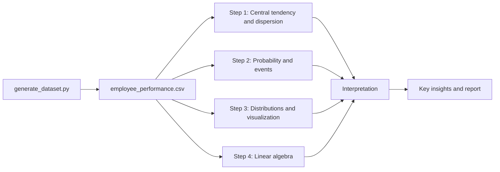

# Employee Performance & Promotion Analysis

**Practical Exam: Mathematics & Advanced Statistics** (Theory + Practical, 6 hours)
*Red & White Skill Education*


A statistics and linear-algebra project that explores **employee performance** and the **probability of promotion** using Python (NumPy, pandas, SciPy, Matplotlib, Seaborn). It covers every task of the exam paper: Part A (8 short theory answers) and Part B (4 practical steps), with a written interpretation after each result.

---

## Table of Contents

1. [Project Overview](#1-project-overview)
2. [Repository Structure](#2-repository-structure)
3. [Dataset](#3-dataset)
4. [Quick Start](#4-quick-start)
5. [Workflow](#5-workflow)
6. [Methodology & Formulas](#6-methodology--formulas)
7. [Results](#7-results)
8. [Key Insights](#8-key-insights)
9. [Exam Task Coverage Checklist](#9-exam-task-coverage-checklist)
10. [Assumptions & Limitations](#10-assumptions--limitations)
11. [Possible Extensions](#11-possible-extensions)

---

## 1. Project Overview

| Item | Details |
|---|---|
| **Goal** | Write short theory explanations and run Python-based analysis of employees' performance and probability of promotion |
| **Dataset** | `employee_performance.csv`, 4000 records, 8 fields, no missing values |
| **Topics** | Descriptive statistics, probability, conditional probability, distributions, skewness and kurtosis, Q-Q plots, vectors, dot product, norms, angle between vectors |
| **Deliverables** | Jupyter notebook (all calculations) and Word report (theory, outputs, insights) |

---

## 2. Repository Structure

```text
employee-performance-analysis/
── Images/
│   ├── Histogram of Performance_Score With Gaussian Curve.png
│   └── Q-Q Plot Of Project_completed.png
├── employee_performance.csv
├── Employee_Performance_Analysis_Corrected.ipynb
├── Employee_Performance_Report_Corrected.docx
├── generate_dataset.py
├── requirements.txt
└── README_Corrected.md
```

---

## 3. Dataset

`employee_performance.csv` is a **synthetic dataset** (the exam asks for the data to be generated with an AI tool). The included `generate_dataset.py` can create a reproducible synthetic dataset using random seed `42`. Running it creates a new comparable dataset; it does not reproduce the supplied CSV byte-for-byte.

### 3.1 Data Dictionary

| Column | Type | Description | Observed range / values |
|---|---|---|---|
| `Employee_ID` | string | Unique ID (`EMP0001` to `EMP4000`) | 4000 unique values |
| `Department` | categorical | Employee's department | IT, Sales, Operations, Marketing, Finance, HR |
| `Age` | integer | Age in years | 22 to 60 (mean about 34.2) |
| `Salary` | integer | Annual salary in INR (rounded to nearest 5,000) | 325,000 to 3,010,000 |
| `Projects_Completed` | integer | Number of projects completed (count data) | Non-negative integers, mean about 8 |
| `Working_Hours` | integer | Weekly working hours | 30 to 61 (mean about 45) |
| `Performance_Score` | float | Performance score (0 to 100) | 32.7 to 100 (mean about 68.5) |
| `Promotion_Status` | categorical | Whether the employee was promoted | Yes / No |

### 3.2 Department Distribution

| Department | Employees |
|---|---|
| IT | 1066 |
| Sales | 771 |
| Operations | 611 |
| Marketing | 609 |
| Finance | 540 |
| HR | 403 |

### 3.3 How the Data Was Simulated

The relationships were built to be realistic, so the analysis gives meaningful results:

- **Salary** depends on the department's base pay and on experience (`Age - 22`), with log-normal noise. This gives a right-skewed distribution like real pay data.
- **Projects_Completed** is drawn from a Poisson distribution (mean 8) plus occasional extra projects for high achievers.
- **Performance_Score** rises with projects completed, working hours and experience, plus Gaussian noise, and is clipped to 0 to 100.
- **Promotion_Status** is drawn from a logistic model that depends mainly on `Performance_Score`, with a small bonus for IT.

---

## 4. Quick Start

### 4.1 Requirements

- Python 3.9 or newer
- Packages listed in `requirements.txt`

### 4.2 Installation

```bash
# 1. (Optional) create a virtual environment
python -m venv venv
source venv/bin/activate          # Windows: venv\Scripts\activate

# 2. Install dependencies
pip install -r requirements.txt
```

### 4.3 Run the Analysis

```bash
# (Optional) generate a new comparable synthetic dataset
python generate_dataset.py

# Launch the notebook
jupyter notebook Employee_Performance_Analysis_Corrected.ipynb
```

Then choose **Kernel > Restart & Run All**. The CSV must be in the **same folder** as the notebook.

---

## 5. Workflow



---

## 6. Methodology & Formulas

### Step 1: Central Tendency & Dispersion
- Mean: x̄ = Σxᵢ / n
- Median: middle value of the sorted data
- Mode: most frequent value (all tied modes are reported)
- Sample variance: s² = Σ(xᵢ − x̄)² / (n − 1)
- Standard deviation: s = √s²

### Step 2: Probability & Events
- P(Promotion) = promoted employees / total employees
- Contingency table: `pd.crosstab(Promotion_Status, Department, margins=True)`
- Conditional probability:
  **P(A | B) = P(A ∩ B) / P(B)**, where A = Promotion and B = Performance_Score > 80

### Step 3: Distributions & Visualization
- Histogram of `Performance_Score` (density scale) with a Gaussian curve using sample mean and standard deviation
- Skewness (Fisher–Pearson) and excess kurtosis (Fisher, normal = 0) of `Salary` using `scipy.stats`
- Q-Q plot of `Projects_Completed` against the normal distribution using `scipy.stats.probplot`

### Step 4: Linear Algebra
Each of the first 5 employees is a vector **v = [Projects_Completed, Working_Hours]**.

| Operation | Formula |
|---|---|
| Dot product | a · b = Σ aᵢbᵢ |
| Norm 1 (L1) | ‖a‖₁ = Σ \|aᵢ\| |
| Norm 2 (L2) | ‖a‖₂ = √(Σ aᵢ²) |
| Angle | θ = arccos( a · b / (‖a‖ ‖b‖) ) |

---

## 7. Results

### 7.1 Step 1: Central Tendency & Dispersion

| Metric | Value |
|---|---|
| Salary mean | 858,597.50 |
| Salary median | 820,000.00 |
| Salary mode | 720,000 (occurs 40 times; 4 values tie) |
| Projects_Completed variance | 8.8221 |
| Projects_Completed standard deviation | 2.9702 |

### 7.2 Step 2: Probability & Events

| Metric | Value |
|---|---|
| P(Promotion) | **0.3038** (1215 of 4000) |
| P(Score > 80) | 0.1368 (547 employees) |
| P(Promotion ∩ Score > 80) | 0.0968 (387 employees) |
| **P(Promotion \| Score > 80)** | **0.7075 (70.75%)** |
| P(Promotion \| Score ≤ 80) | 0.2398 (23.98%) |

**Contingency table (Promotion_Status x Department)**

| Promotion_Status | Finance | HR | IT | Marketing | Operations | Sales | Total |
|---|---|---|---|---|---|---|---|
| No | 374 | 278 | 742 | 420 | 414 | 557 | 2785 |
| Yes | 166 | 125 | 324 | 189 | 197 | 214 | 1215 |
| **Total** | 540 | 403 | 1066 | 609 | 611 | 771 | 4000 |

### 7.3 Step 3: Distributions & Visualization

| Metric | Value |
|---|---|
| Performance_Score mean / standard deviation | 68.5 / 10.5 (approximately normal) |
| Salary skewness | 1.0185 (right-skewed) |
| Salary excess kurtosis | 2.2281 (Pearson kurtosis 5.2281; heavy tails) |

The histogram follows the Gaussian curve closely. The Q-Q plot of `Projects_Completed` is near the line in the middle, with steps (count data) and a slightly heavier right tail.

### 7.4 Step 4: Linear Algebra

| Operation (Employee 1 = [14, 44], Employee 2 = [10, 44]) | Value |
|---|---|
| Dot product | 2076 |
| Norm 1 of Employee 1 | 58.0000 |
| Norm 2 of Employee 1 | 46.1736 |
| cos θ | 0.996426 |
| Angle | **4.8459°** |

All pairwise angles among the first 5 employees are below 9° (smallest 0.867° between E2 and E3, largest 8.808° between E1 and E4).

---

## 8. Key Insights

1. **About 30.4% of employees are promoted**, roughly 1 in 3.
2. **Performance drives promotion**: employees scoring above 80 have a **70.7%** chance of promotion, versus **24.0%** for the rest, about **3 times higher**. Promotion and high performance are not independent events.
3. **Department matters little**: promotion rates range only from 27.8% (Sales) to 32.2% (Operations).
4. **Output beats long hours**: `Projects_Completed` has a correlation of **0.61** with `Performance_Score`, while `Working_Hours` has only **0.17**.
5. **Salary is right-skewed** (skewness 1.02, mean 858,598 > median 820,000), so the median describes a typical salary better than the mean. Salary also has heavy tails.

---

## 9. Exam Task Coverage Checklist

| Task | Status | Location |
|---|---|---|
| Part A: 8 theory questions | Done | Notebook (Part A) and Report |
| Step 1: mean, median, mode of Salary | Done | Notebook (Step 1) |
| Step 1: variance and standard deviation of Projects_Completed | Done | Notebook (Step 1) |
| Step 2: probability of promotion | Done | Notebook (Step 2) |
| Step 2: contingency table (Promotion_Status x Department) | Done | Notebook (Step 2) |
| Step 2: P(Promotion \| Performance_Score > 80) | Done | Notebook (Step 2) |
| Step 3: histogram of Performance_Score with Gaussian curve | Done | Notebook (Step 3) |
| Step 3: skewness and kurtosis of Salary | Done | Notebook (Step 3) |
| Step 3: Q-Q plot of Projects_Completed | Done | Notebook (Step 3) |
| Step 4: dot product between two employee vectors | Done | Notebook (Step 4) |
| Step 4: Norm 1 and Norm 2 of a work vector | Done | Notebook (Step 4) |
| Step 4: angle between two work vectors | Done | Notebook (Step 4) |
| Deliverable 1: Python file / Jupyter notebook | Done | `Employee_Performance_Analysis_Corrected.ipynb` |
| Deliverable 2: PDF/Word report (theory, outputs, 3 to 5 insights) | Done | `Employee_Performance_Report_Corrected.docx` |

---

## 10. Assumptions & Limitations

- The dataset is **synthetic**, so findings describe the simulated data and not a real company.
- Variance and standard deviation use the **sample formula** (`ddof = 1`), the pandas default.
- The mode is not unique for `Salary`; the first tied value (720,000) is reported, and the others are printed too.
- Salary is in **INR per year**.
- Step 4 uses the **raw** (unscaled) vector components, so `Working_Hours` dominates the angle. Standardizing the features would give a fairer comparison.
- Correlation shows association, not causation.

---

## 11. Possible Extensions

- **Logistic regression** to predict `Promotion_Status` and report odds ratios
- **Bayes' theorem** to compute P(High performer | Promoted)
- **Chi-square test** of independence between Department and Promotion_Status
- **Hypothesis tests** (t-test / Mann-Whitney U) on salary between promoted and non-promoted groups
- **PCA** on the standardized numeric features, with a scree plot and 2D projection
- **Feature scaling** before the vector-angle analysis in Step 4
- **Log transform** of `Salary` to reduce skewness

---

## 👨‍💻 Author

**Mukesh Kote**

GitHub: [@Mukesh-Kote-Official](https://github.com/Mukesh-Kote-Official)

**Project:** Employee-Performance-and-Promotion-Analysis

---

<p align="center">
  <strong>⭐ If you find this project useful, consider giving it a star!</strong>
</p>

<p align="center">
  Thank you for visiting my repository!
</p>
